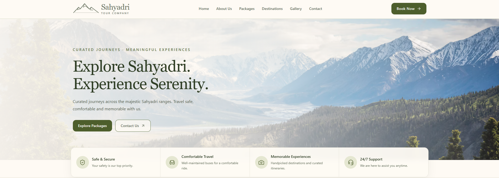
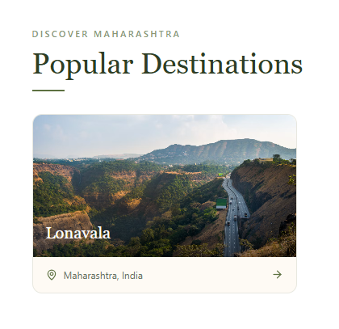
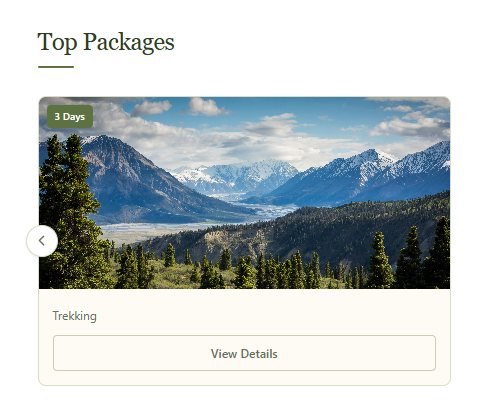
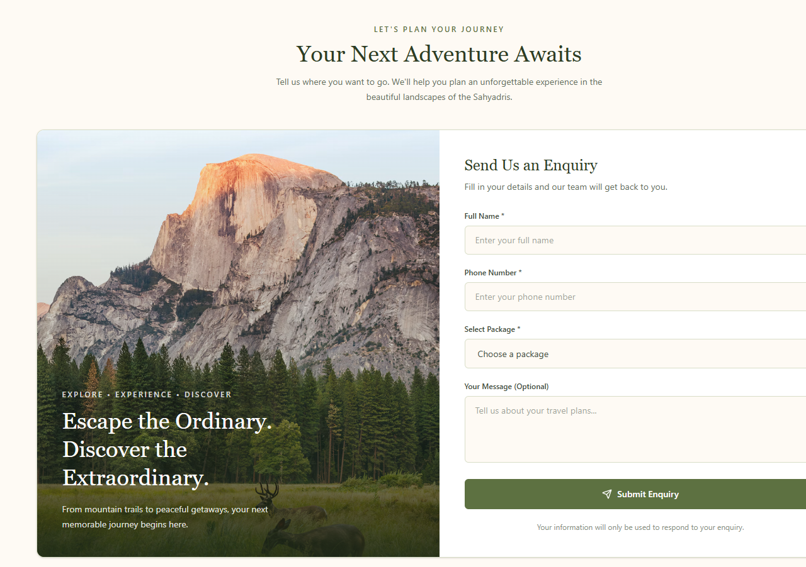
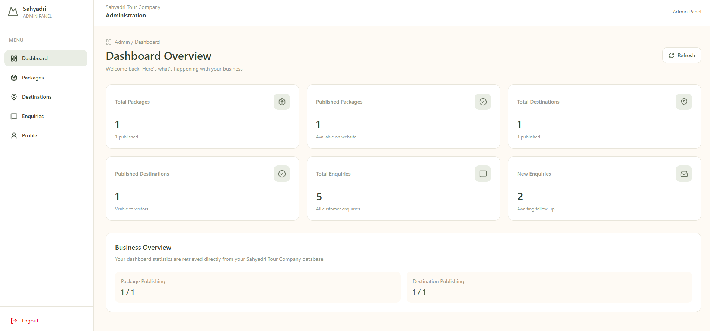
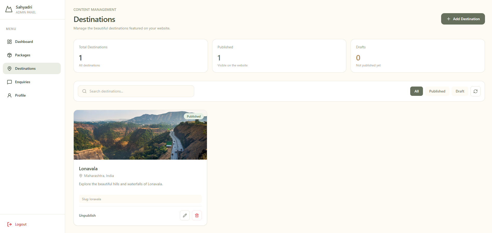

# 🏔️ Sahyadri Tour Company

### Full-Stack Travel & Tour Management Platform

A responsive travel website with dynamic destination and package listings, customer enquiry handling, and a protected admin dashboard for managing website content.

🌐 **Live Website:** https://sahyadri-tour-company.vercel.app/  
⚙️ **Backend API:** https://sahyadri-tour-company-api.onrender.com/  
💻 **GitHub:** https://github.com/saishmekal/SahyadriTourCompany

---

## 📸 Screenshots

### Public Website

| Homepage | Destinations |
|---|---|
|  |  |

| Tour Packages | Customer Enquiry |
|---|---|
|  |  |

### Admin Dashboard

| Dashboard Overview | Destination Management |
|---|---|
|  |  |

*Screenshots show the current deployed project state. The destination and package sections currently contain sample entries; additional content can be added through the admin dashboard.*

---

## ✨ Features

### Public Website
- Responsive travel website for desktop, tablet, and mobile.
- Homepage with hero section, company information, benefits, gallery, and testimonials.
- Destination and tour package content loaded from backend APIs.
- Individual package detail pages.
- Customer enquiry form with package selection.
- WhatsApp contact integration.
- FAQ, Terms & Conditions, Privacy Policy, and Cancellation Policy pages.
- Custom Sahyadri mountain favicon.

### Admin Dashboard
- Admin login and protected dashboard routes.
- JWT authentication using HTTP-only cookies.
- CSRF protection for sensitive requests.
- Dashboard overview with package, destination, and enquiry statistics.
- Create, view, update, and delete tour packages.
- Create, view, update, and delete destinations.
- View and manage customer enquiries.
- Admin profile management.

### Backend & Security
- REST API built with Express and TypeScript.
- MongoDB data persistence using Mongoose.
- Request validation with Zod.
- Password hashing with bcryptjs.
- Authentication and request-protection middleware.
- CORS, Helmet security headers, and rate limiting.
- Environment-based configuration.

---

## 🛠️ Tech Stack

| Area | Technologies |
|---|---|
| Frontend | React 19, TypeScript |
| Styling | Tailwind CSS 4 |
| Build Tool | Vite |
| Routing | React Router |
| UI & Animation | Framer Motion, Lucide React |
| Forms & Validation | React Hook Form, Zod |
| Backend | Node.js, Express 5, TypeScript |
| Database | MongoDB Atlas |
| ODM | Mongoose |
| Authentication | JWT, bcryptjs, HTTP-only cookies |
| Security | CSRF protection, Helmet, CORS, rate limiting |
| Containerization | Docker, Docker Compose |
| API Testing | Postman |
| Deployment | Vercel, Render, MongoDB Atlas |
| Version Control | Git, GitHub |

---

## 🏗️ Architecture

The application uses a client-server architecture. The React frontend is deployed on Vercel and sends `/api` requests through a Vercel rewrite to the Express backend hosted on Render. The backend communicates with MongoDB Atlas through Mongoose.

```text
                 Visitors / Admin
                        |
                        v
             React + TypeScript Client
                     Vercel
                        |
                  /api requests
                        |
                 Vercel Rewrite
                        |
                        v
              Express + TypeScript API
                     Render
                        |
             Routes / Controllers /
             Middleware / Validators
                        |
                        v
                    Mongoose
                        |
                        v
                  MongoDB Atlas
```

### Deployment
- **Frontend:** Vercel
- **Backend:** Render (Docker-based deployment)
- **Database:** MongoDB Atlas
- **API proxy:** Vercel rewrites `/api` requests to the Render API.

---

## 📁 Project Structure

```text
SahyadriTourCompany/
├── client/
│   ├── public/
│   ├── src/
│   │   ├── admin/
│   │   │   ├── components/
│   │   │   └── pages/
│   │   ├── components/
│   │   ├── context/
│   │   ├── pages/
│   │   ├── App.tsx
│   │   └── main.tsx
│   ├── index.html
│   ├── vercel.json
│   └── package.json
│
├── server/
│   ├── scripts/
│   ├── src/
│   │   ├── config/
│   │   ├── controllers/
│   │   ├── middleware/
│   │   ├── models/
│   │   ├── routes/
│   │   │   ├── admin.routes.ts
│   │   │   ├── auth.routes.ts
│   │   │   ├── destination.routes.ts
│   │   │   ├── enquiry.routes.ts
│   │   │   ├── health.routes.ts
│   │   │   └── package.routes.ts
│   │   ├── utils/
│   │   ├── validators/
│   │   └── server.ts
│   ├── Dockerfile
│   └── package.json
│
├── docs/
│   └── screenshots/
├── docker-compose.yml
└── README.md
```

---

## 🔌 API Overview

The backend route modules are organized by responsibility:

| Route module | Responsibility |
|---|---|
| `health.routes.ts` | API health check |
| `auth.routes.ts` | Admin authentication |
| `admin.routes.ts` | Admin dashboard and management operations |
| `package.routes.ts` | Tour package endpoints |
| `destination.routes.ts` | Destination endpoints |
| `enquiry.routes.ts` | Customer enquiry endpoints |

The API is mounted under `/api`. The root health endpoint is available at `/`.

---

## 🚀 Run Locally

### Prerequisites
- Node.js and npm
- Git
- MongoDB Atlas account or a MongoDB instance
- Docker Desktop (optional, for containerized development)

### 1. Clone the repository

```bash
git clone https://github.com/saishmekal/SahyadriTourCompany.git
cd SahyadriTourCompany
```

### 2. Configure and run the backend

```bash
cd server
npm install
```

Create `server/.env`:

```env
NODE_ENV=development
PORT=5000
MONGODB_URI=your_mongodb_connection_string
JWT_SECRET=your_jwt_secret
JWT_EXPIRES_IN=1d
CSRF_SECRET=your_csrf_secret
CLIENT_ORIGIN=http://localhost:5173
```

Start the backend development server:

```bash
npm run dev
```

The backend runs at `http://localhost:5000` with the configured port.

### 3. Configure and run the frontend

Open a second terminal:

```bash
cd client
npm install
```

Create `client/.env.development`:

```env
VITE_API_URL=http://localhost:5000/api
VITE_SITE_URL=http://localhost:5173
```

Start the frontend:

```bash
npm run dev
```

Vite prints the local frontend URL in the terminal (typically `http://localhost:5173`).

### 4. Available scripts

**Client (`client/`)**

| Command | Description |
|---|---|
| `npm run dev` | Start Vite development server |
| `npm run build` | Type-check and build the frontend |
| `npm run lint` | Run ESLint |
| `npm run preview` | Preview the production build |

**Server (`server/`)**

| Command | Description |
|---|---|
| `npm run dev` | Start backend with `tsx watch` |
| `npm run build` | Compile TypeScript |
| `npm start` | Start compiled backend |
| `npm run seed:admin` | Run the admin initialization script |

### 5. Docker

From the repository root, with the required environment configuration in place:

```bash
docker compose up --build
```

Stop the local containers:

```bash
docker compose down
```

---

## 🔐 Environment & Security

- Keep secrets and connection strings in environment variables.
- Do not commit `.env` files or production credentials.
- Configure the production frontend origin in the backend environment.
- Use strong, unique JWT and CSRF secrets in production.
- The admin seed script should only be run when intentionally initializing an admin account.

---

## ☁️ Production Deployment

| Component | Deployment |
|---|---|
| Frontend | [Vercel](https://vercel.com/) |
| Backend | [Render](https://render.com/) |
| Database | [MongoDB Atlas](https://www.mongodb.com/atlas) |

- **Live website:** https://sahyadri-tour-company.vercel.app/
- **Backend health endpoint:** https://sahyadri-tour-company-api.onrender.com/

The Render free service may take some time to respond after periods of inactivity.

---

## 📚 What This Project Demonstrates

- Full-stack application development with React, TypeScript, Node.js, and Express.
- Designing and consuming REST APIs.
- MongoDB schema design and database integration.
- Authentication, protected routes, and CSRF protection.
- Admin dashboard development and CRUD workflows.
- Form handling and validation.
- Docker-based local development and backend deployment.
- Production deployment and frontend-backend integration.

---

## 👨‍💻 Author

**Saish Mekal**  
BE Computer Engineering | Full-Stack Developer

- GitHub: https://github.com/saishmekal
- LinkedIn: *Add your LinkedIn profile URL*

---

If you find this project interesting, feel free to explore the repository and share your feedback.

**Built with ❤️ for Sahyadri Tour Company.**
